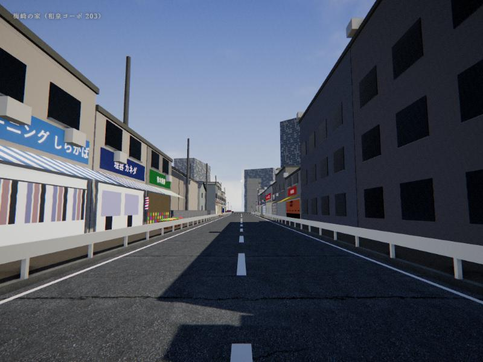
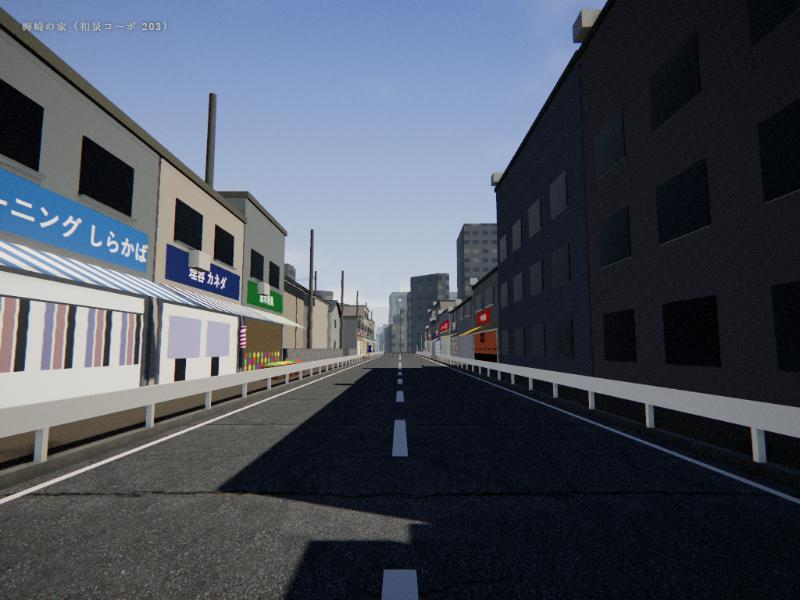
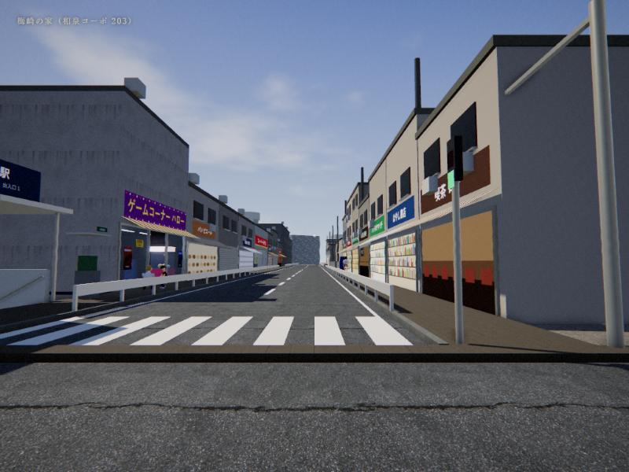
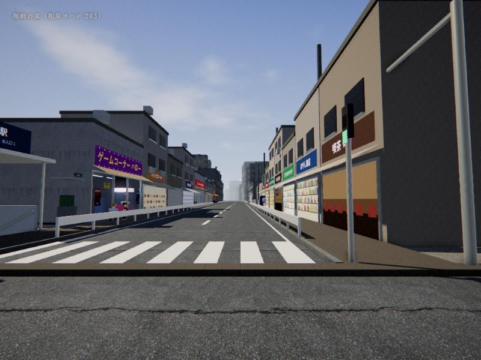
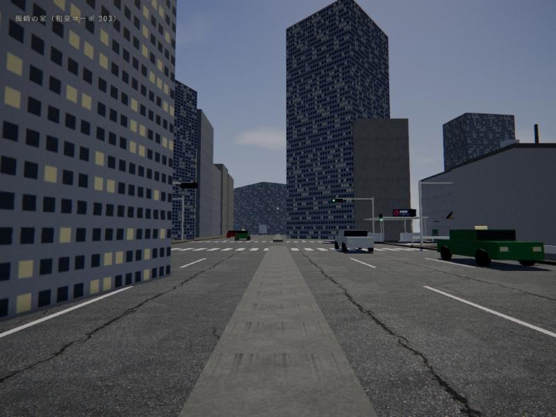
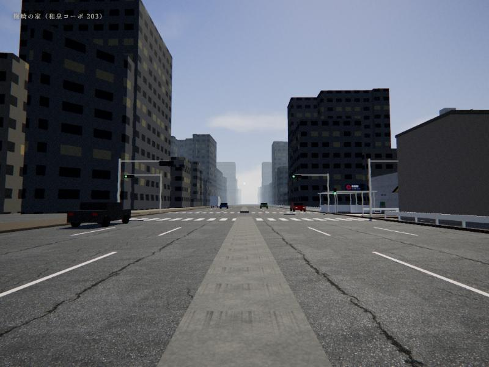
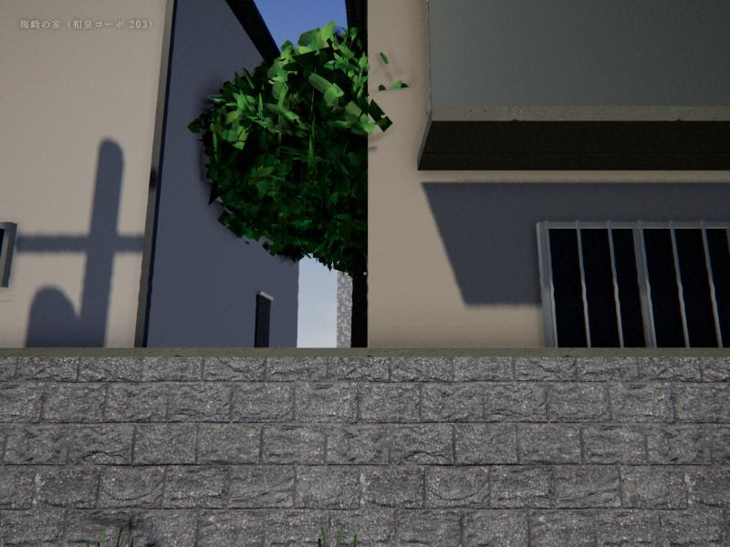
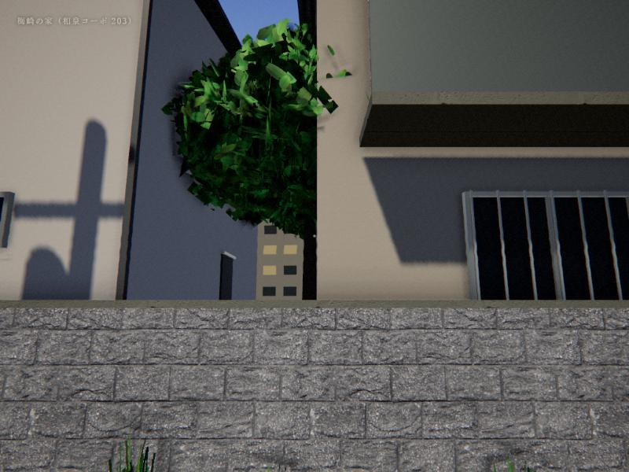
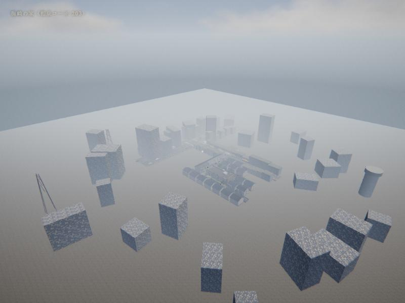
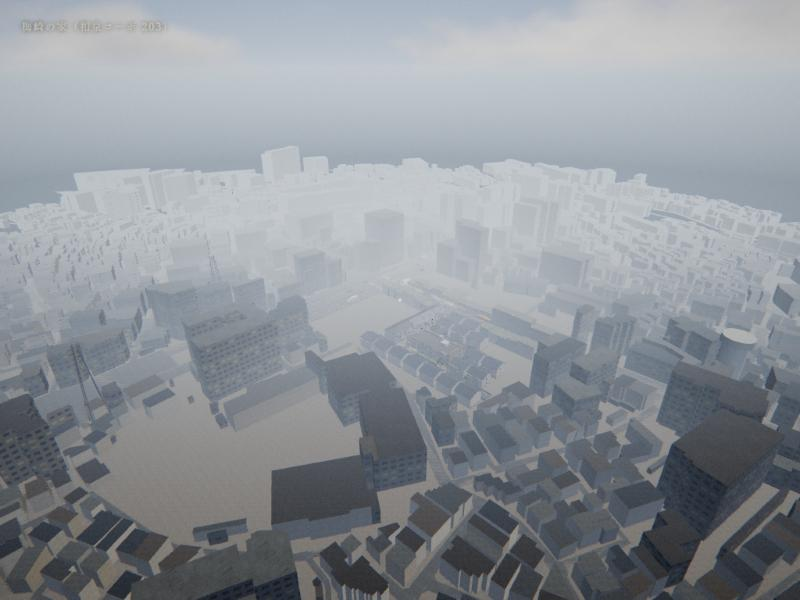

# 試作：PLATEAU で「遊べる範囲の外」を本物の街にする

ブランチ `plateau-trial` の試作です。`main` のゲームには入っていません。

- 国土交通省 PLATEAU（杉並区 2025年度）の建物・道路データから、方南町駅を中心に半径450mを取り出した（建物 約2500棟）
- 手で作った範囲（商店街・環七の交差点・マンションまわり）はそのまま。その外側の「作り物の遠景ビル」だけを本物の配置と高さの建物に入れ替えた
- `?plateau` を付けて開くと試作版、付けなければ今までどおり（同じファイルで見比べられる）

## 見比べ

| 場所 | 今まで（main） | 試作（?plateau） |
|---|---|---|
| ① 商店街から環七の方を見る |  |  |
| ② 交差点から商店街を見る |  |  |
| ③ 環七を南に見る |  |  |
| ④ 北側の道から北を見る |  |  |
| ⑤ 上空から |  |  |

真上から見た位置合わせ：[topview.svg](topview.svg)（赤＝ゲームの泉南通りと環七、青＝手で作った範囲）

## 自分で見比べる
1. `node serve.js`
2. 今まで：http://localhost:8765/?debug ／ 試作：http://localhost:8765/?debug&plateau
3. コンソールで同じ場所に立てる：`TP(45, -52, 90, 0, 6)`（x, z, 向き[度], 高さ, 見上げ[度]）、上空は `CAM(160, 150, 170, -50, 0, -40)`

## 作り直し方
1. PLATEAU の杉並区 CityGML（https://www.geospatial.jp/ckan/dataset/plateau-13115-suginami-ku-2025 ）をダウンロード
2. 駅まわりの区画 `533945[12][123]` の `udx/bldg` と `udx/tran` を展開
3. `node tools/plateau_convert.js <展開したフォルダ>` → `assets/plateau/plateau.json`
4. `node build.js`
- 位置と向きの合わせは `tools/plateau_anchor.json`（交差点の緯度経度・回転）

## 気づいたこと・課題
- データは今（2025年度）の街。1997年にはなかった高い建物も混ざっている
- 建物は「箱」の形（LOD1）で、壁は1種類の窓模様。近くで見ると単調
- 本物の環七は、ゲームの環七より少し広い
- データの大きさは約330KB（ゲーム全体の約0.3%）

3D都市モデル：国土交通省 PLATEAU（杉並区 2025年度）を加工して作成
